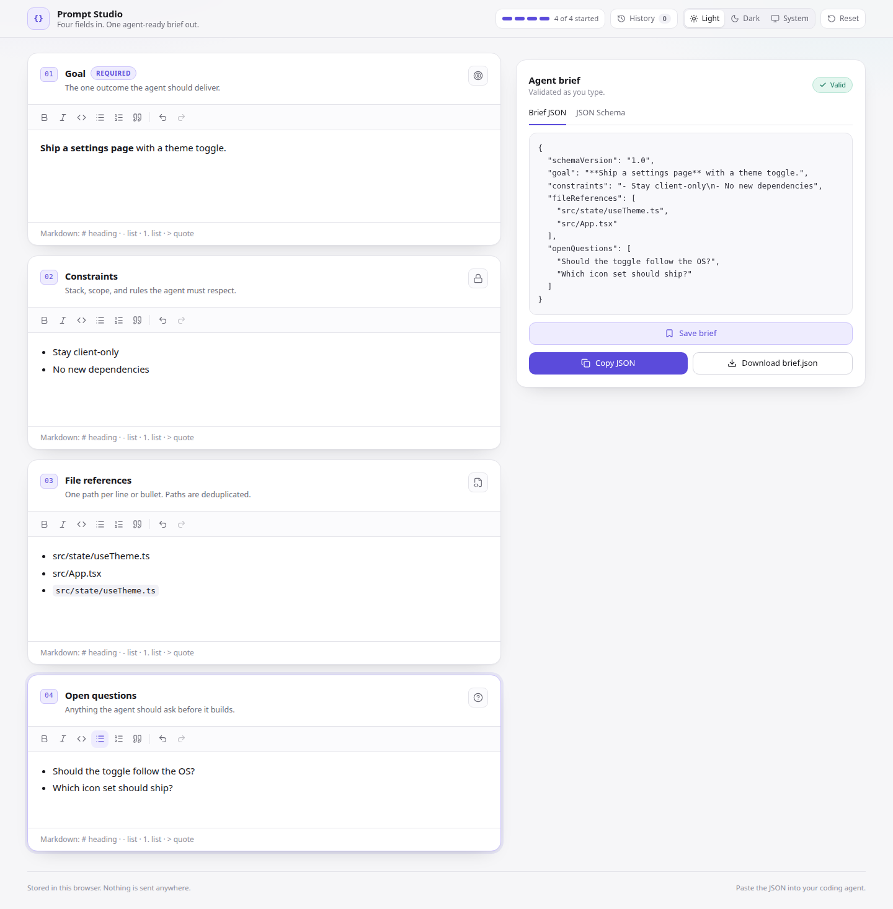
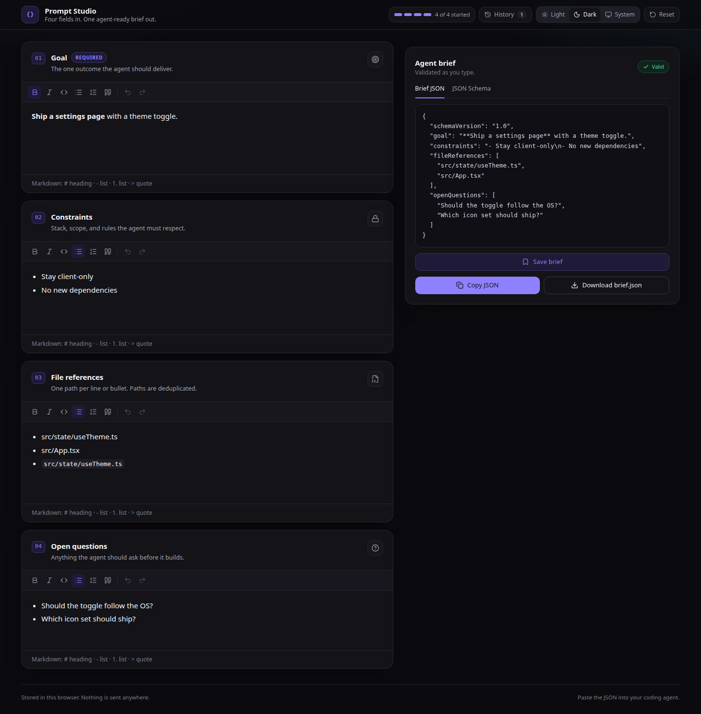
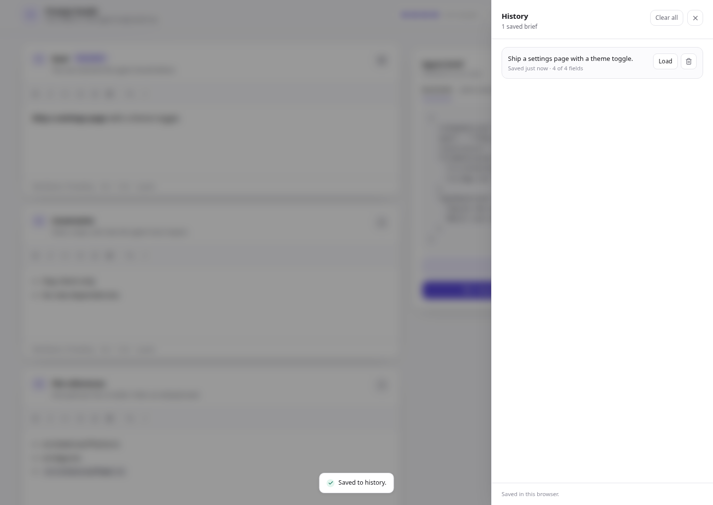

# Prompt Studio

Four fields in. One agent-ready brief out.

Write a goal, constraints, file references, and open questions. Prompt Studio turns them into a validated JSON brief you can paste into a coding agent.







## What it does

- Four rich-text fields share one editor: bold, italic, inline code, bullet and numbered lists, quotes, headings, undo, and redo. Typing `- `, `1. `, `# `, or `> ` starts the matching block.
- The right panel updates on every keystroke with the JSON brief. Copy it or download `brief.json`.
- The JSON Schema tab shows the draft 2020-12 schema the payload is validated against. Zod generates both from one declaration.
- Light, dark, and system themes. The choice survives a reload.
- Save the current brief to history. The drawer lists saved snapshots with a title, relative time, and field count. Load one back into the editor, delete it, or clear all. History keeps the newest 50 entries in this browser.
- Drafts autosave to localStorage under `prompt-studio.draft.v1`. Nothing leaves the browser.

## Run it

```sh
npm install
npm run dev
```

Open http://localhost:5173.

```sh
npm test        # pure brief pipeline
npm run typecheck
npm run build
```

## The payload

```json
{
  "schemaVersion": "1.0",
  "goal": "**Ship a settings page** with a theme toggle.",
  "constraints": "- Stay client-only\n- No new dependencies",
  "fileReferences": ["src/state/useTheme.ts", "src/App.tsx"],
  "openQuestions": [
    "Should the toggle follow the OS?",
    "Which icon set should ship?"
  ]
}
```

| Field | Payload key | Shape |
| --- | --- | --- |
| Goal | `goal` | Markdown string, required |
| Constraints | `constraints` | Markdown string |
| File references | `fileReferences` | String array, one path per item, deduplicated |
| Open questions | `openQuestions` | String array, one question per item |

Prose fields keep inline formatting as Markdown. List fields flatten each top-level block and nested list item into one string. File paths lose wrapping backticks, quotes, list markers, and trailing punctuation before deduplication.

## How the data moves

```text
FieldEditor.onUpdate [1] ← one TipTap instance per field
├── useBriefDraft.setField [1a] ← replace one snapshot entry
│   ├── docs snapshot [1a1]
│   │   ├── debounce 300 ms → localStorage draft [1a1a]
│   │   └── compileBrief(docs) [1a1b] ← memoized per snapshot
│   │       ├── docToMarkdown(goal, constraints) [1a1b1]
│   │       ├── docToItems(files).map(normalizePath) [1a1b2]
│   │       ├── dedupe file paths [1a1b3]
│   │       ├── BriefSchema.safeParse(candidate) [1a1b4] ← zod contract
│   │       └── JSON.stringify(value, null, 2) [1a1b5]
│   └── replace(docs) on history load [1a2] ← remounts editors
├── OutputPanel [1b]
│   ├── Save brief [1b1] → useHistory.save [1b1a]
│   │   ├── addEntry + newest duplicate check [1b1a1]
│   │   ├── localStorage history write first [1b1a2]
│   │   └── setEntries after a successful write [1b1a3]
│   ├── Copy JSON [1b2] ← disabled until valid
│   ├── Download brief.json [1b3]
│   └── JSON Schema tab [1b4] ← z.toJSONSchema(BriefSchema)
└── HistoryDrawer [1c]
    ├── Load → replace(docs) + close [1c1]
    └── Delete or clear → persist then setEntries [1c2]
```

The same `Brief` type comes from `BriefSchema`, so the runtime validator and the displayed schema cannot drift. `src/brief/compile.ts` is the only place that assembles the payload. History stores the four ProseMirror documents, so loading a saved brief rebuilds the JSON from the same compiler instead of from a second stored format.

## Project layout

```text
src/
├── brief/          contract, docs model, registry, markdown serializer, compiler, tests
├── history/        pure entries, titles, relative time, tests
├── editor/         TipTap field, toolbar, action table
├── state/          draft, history, and theme hooks
├── ui/             form cards, output panel, history drawer, theme toggle, toast
├── App.tsx         header, grid, reset, completion meter
└── styles.css      design tokens and editor typography
```

## Design

Colors and spacing live in `src/styles.css` as CSS variables mapped into Tailwind v4 through `@theme inline`. The `dark` class on `<html>` swaps the token set. An inline script in `index.html` applies the stored theme before first paint.

The layout is a two-column workspace at 1024 px and wider, and a single column below that. Every control is a real button or a labelled editor, the toolbar exposes `aria-pressed`, the output tabs follow the WAI-ARIA tabs pattern, and validation messages sit in live regions.

`src/brief/` and `src/history/` are pure. They import neither React nor the DOM, so both can move into a workspace package without edits. `src/state/` holds the React adapters, and the draft and history keys have separate writers.

## Stitch MCP

The app was built without Stitch because no Stitch MCP server or API key was configured in this environment. `docs/stitch.md` has the setup commands, the OpenCode config, and the prompt to regenerate this screen in Stitch. The four-field layout, tokens, and components are isolated, so a Stitch design can replace the visual layer without touching the brief pipeline.

## Verification

`npm test` covers the serializer, item flattening, path normalization, schema shape, parse failures, issue mapping, and the history model. `scripts/verify-ui.cjs` drives the real app in Chrome through 38 checks: typing, formatting, deduplication, save, duplicate save, load, delete, copy, download, schema tab, reload persistence, reset, and dark and light layouts. Start the dev server first, then run:

```sh
npm run verify:ui
```
